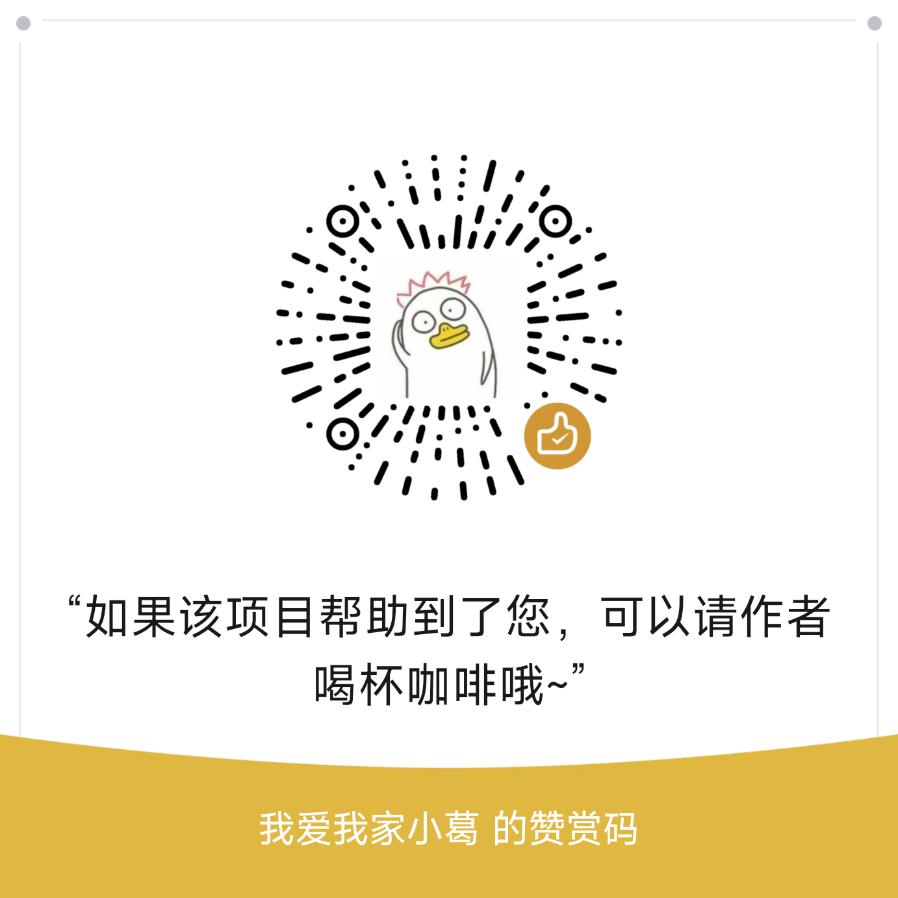
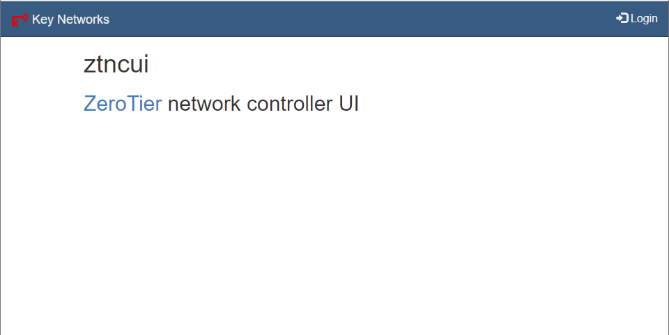
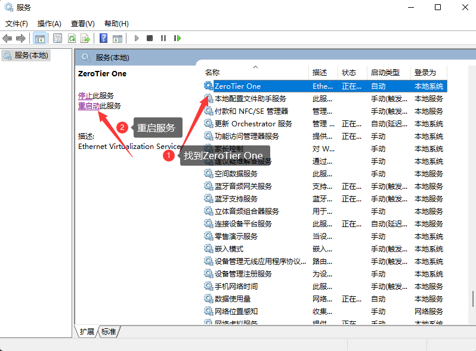

# Docker ZeroTier Planet

[简体中文](README.md) · [English](README.en.md)

Deploy your own ZeroTier Planet on a Linux server with Docker. The deployment also provides a web-based network management interface and a download service for `planet` and `moon` files. It is intended for users who want to manage their own ZeroTier root node and networks.

> **Before you start:** Clients must replace their `planet` file to use the self-hosted Planet. Running your own root node does not guarantee direct connections between devices, nor does it mean all application traffic will—or will not—pass through this server. The management interface on a new installation uses HTTP on the host loopback address.

<a href="https://edgeone.ai/?from=github">
   CDN acceleration and security protection for this project are sponsored by Tencent EdgeOne
</a>

## Advertisements

- [One-click Rainyun container deployment—buy a server on Rainyun](https://app.rainyun.com/apps/rca/store/6215?ref=220429)
- [MyHeadScale—5 devices free forever, unlimited traffic](https://hs.bj.markxu.vip/?from=github)
- [Bandwagonhost—premium CN2 routes](https://bandwagonhost.com/aff.php?aff=82099)

## Community and Support

- [Telegram group](https://t.me/+JduuWfhSEPdlNDk1)
- QQ groups:
  - 692635772
  - 785620313
  - 316239544
  - 1027678459
  - 651935808

If you find this project helpful, you can support it:



WeChat official account:


## Contents

- [Advertisements](#advertisements)
- [Community and Support](#community-and-support)
- [Quick Start](#quick-start): prepare a server, deploy the container, and create a network
- [Connect Clients](#connect-clients): replace `planet` and join the network on each platform
- [Operations and Security](#operations-and-security): backups, updates, removal, Compose, and HTTPS
- [FAQ](#faq): connectivity, ports, IP changes, and more
- [Project and Community](#project-and-community): roadmap, risk statement, acknowledgments, and references

## Quick Start

### 1. Prepare a Server

Prepare a Linux server with a **public IPv4 or IPv6 address**. Install Docker and Git, and make sure the host has `flock` and `findmnt` (util-linux). The image verification workflow covers `linux/amd64` and `linux/arm64`. If you have not installed Docker, consult the [official Docker installation guide](https://docs.docker.com/engine/install/).

Allow the ports you actually use through both the server firewall and your cloud provider's security group. You can change the default ports when the installer prompts you:

| Default port | Protocol | Purpose |
| --- | --- | --- |
| `9994` | TCP, UDP | ZeroTier communication |
| `3443` | TCP | Web management interface, bound to `127.0.0.1` on a new installation |
| `3000` | TCP | `planet` / `moon` download service; expose it externally only if remote downloads are needed |

> Avoid exposing the management interface or download endpoint to untrusted users. Treat download links and their keys as credentials.

Use Docker Engine 28.0.0 or newer when you rely on loopback binding to restrict management access. On older Docker releases, other hosts on the same network segment may reach the port. Restrict access with the host firewall first. [Docker port publishing](https://docs.docker.com/engine/network/port-publishing/)

### 2. Run the Deployment Script

```bash
git clone https://github.com/xubiaolin/docker-zerotier-planet.git
cd docker-zerotier-planet
./deploy.sh
```

For a first installation, select **1. Install or reinstall (keep existing data)** and enter the ZeroTier, management interface, and file download ports. Then choose whether to detect your server's public IP automatically or enter it manually. The script calls Docker directly and stores configuration and data under `data/zerotier/` in the current directory.

**To retry an interrupted installation or reinstall, return to the original project directory and select 1 again.** The script reuses the saved IP addresses, ports, and node identity. If a port is already in use on the first start, you can correct it on retry. It tries to start a stopped container running the new image and recreates a missing container from the original data. If a legacy container is stopped or fails its health check, the script uses the upgrade backup procedure to recover the instance. To upgrade a healthy instance, select **3. Update**.

The default image is `xubiaolin/zerotier-planet:latest`. If the selected default image is an older version, the menu builds an updated image from the current source tree. The first build downloads dependencies and compiles ZeroTier. During an upgrade, this happens before the old service stops. If an image pull fails, check Docker's connection to the image registry.

You can also build ahead of time and pass the image ID on the deployment host to the menu. For `DOCKER_IMAGE`, use a build from this checkout or an image verified by the current release workflow. Select **1** for a fresh install or **3** to upgrade an existing deployment. If building on another host, use the deployment host's architecture and load the image onto the deployment host first.

```bash
docker build -t zerotier-planet:local .
DOCKER_IMAGE=$(docker image inspect --format '{{.Id}}' zerotier-planet:local) ./deploy.sh
```

After deployment, check the container and its logs:

```bash
docker ps --filter name=myztplanet
docker logs myztplanet
```

### 3. Create a Network and Download Files

1. On the server, retrieve the generated initial password:

   ```bash
   docker exec myztplanet node /app/admin-password.js initial
   ```

   The command displays the password once. Open `http://127.0.0.1:3443` and sign in as `admin`. To connect from another machine, run `ssh -L 3443:127.0.0.1:3443 user@server` and open the same address locally. Substitute your container name or management port if you changed them.
2. On the **Networks** page, click **Add Network**, enter a name, and create the network. Record the generated **Network ID**. To assign virtual IP addresses automatically, configure a range under **Easy Setup** in the network settings.
3. Obtain the `planet` file from the download URL printed by the script or from `./data/zerotier/dist/` on the server. Distribute it to clients that need to connect to this private Planet. The `moon` file is generated in the same directory; this deployment also configures the node itself as a moon, and other nodes may download the file as needed.



> **Back up the entire `data/zerotier/` directory.** In addition to downloadable client files, it contains node identities, signing keys, controller data, and management interface data. Do not commit this directory or download keys to a public repository.

### What's Included

| Component | Purpose |
| --- | --- |
| Planet | ZeroTier root node that helps clients discover the network; clients need the `planet` file generated by this project |
| Moon | This deployment also configures the node as a moon and creates a `.moon` file in `dist` for other nodes to use as needed |
| Controller / web management interface | Create networks, authorize members, and manage address assignments |
| File download service | Provides access to generated files; keep the download key secure |

ZeroTier attempts to connect nodes directly. Whether a direct connection succeeds still depends on both sides' networks, NAT, and firewalls. A self-hosted Planet does not replace end-to-end connectivity troubleshooting.

## Connect Clients

**General process:** Install ZeroTier on the client → back up the existing `planet` file (if any) → put the newly generated file in place → restart the ZeroTier service → join the Network ID you created → authorize the device in the management interface → check its assigned address and connection status.

In the commands below, `0123456789abcdef` is only an **example Network ID**. Replace it with the ID of your own network. Installation paths may vary by distribution and client version; check the actual location on your device.

### Windows

1. Install the [ZeroTier One client](https://www.zerotier.com/download/). Back up any existing file, then put the generated `planet` file at `C:\ProgramData\ZeroTier\One\planet` (`ProgramData` is hidden by default).
2. Restart **ZeroTier One** in Windows Services. In an administrator terminal where `zerotier-cli.bat` is available, join the network:

   ```powershell
   zerotier-cli.bat join 0123456789abcdef
   zerotier-cli.bat peers
   ```

3. Find the device in the management interface, select **Authorized**, and confirm that it receives a virtual IP address. The `peers` output shows the connection status of the Planet and other nodes; **a DIRECT connection to the Planet does not mean every connection between devices is also direct**.



### Linux

Back up any existing `planet` file and copy the new file into the ZeroTier data directory (usually `/var/lib/zerotier-one/planet`). Restart the service and join the network:

```bash
sudo cp planet /var/lib/zerotier-one/planet
sudo systemctl restart zerotier-one
sudo zerotier-cli join 0123456789abcdef
sudo zerotier-cli peers
```

Back up the file at the destination before overwriting it. If your system does not use systemd, use its corresponding service management command. Finally, authorize the device in the management interface.

### macOS

Back up the existing `planet` file and put the new one in `/Library/Application Support/ZeroTier/One/`. Restart ZeroTier One, join the network, and authorize the device in the management interface. The path contains spaces; quote it correctly when working in a terminal. Use the restart method appropriate for your installed client version.

### OpenWrt

First confirm that your ZeroTier plugin supports a custom `planet` file and identify its actual data directory. Some plugins use `/etc/config/zero/planet`. Put the file in the appropriate location, restart ZeroTier in the OpenWrt web interface, join the network, and authorize the device. **Do not create or overwrite system symlinks without verifying the directory layout.**

### Android and iOS

- **Android:** You can refer to the third-party client [ZerotierFix](https://github.com/kaaass/ZerotierFix), which supports custom Planet files. Check its version compatibility and maintenance status before use.
- **iOS** gained custom Planet support in the official ZeroTier One app in version 1.14.2. On Linux, run `base64 -w0 ./data/zerotier/dist/planet`. In the 1.14.2 app, open Settings → Planet → Edit, paste the output, and save. Join the Network ID and authorize the device in the management UI. The 1.16.0 release notes describe importing a Planet via URL or QR code. Some iOS users report a missing settings button or a QR code that opens the app without an import prompt. Check the app version even when the server runs 1.16.2. [App Store version history](https://apps.apple.com/us/app/zerotier-one/id1084101492) · [1.14.2 instructions and screenshots](https://github.com/xubiaolin/docker-zerotier-planet/issues/211) · [ZeroTier changelog](https://docs.zerotier.com/changelog/) · [1.16.0 import reports](https://github.com/zerotier/ZeroTierOne/issues/2599)

## Operations and Security

### Data Directories and Backups

The deployment script mounts the following host directories into the container. Back up all of `data/zerotier/`, not just the `planet` file:

| Host path | Purpose |
| --- | --- |
| `data/zerotier/dist/` | Exported `planet` / `moon` files |
| `data/zerotier/ztncui/` | Management interface configuration and login data |
| `data/zerotier/one/` | ZeroTier node identity, Planet and Moon signing keys, and controller network and member data |
| `data/zerotier/config/` | Public IP addresses, ports, and the file download key |

### In-Place Upgrades and Recovery

You can link `data/` or `data/zerotier/` to another disk, or mount storage directly at `data/zerotier/` or any of the four persistent directories in the table. Upgrades back up the entire data tree under `data/`. Keep the original mounts available during recovery. The script verifies the mounted directories and restores their contents before starting the old container. Use bind mounts for individual directories stored elsewhere. Place each mount at the directory listed in the table. The script checks for deeper mounts before stopping the service.

Automatic upgrades require one Docker bridge network and published ports for ZeroTier TCP and UDP, the management interface, and downloads. The script verifies the active mounts and network configuration before stopping the container. Recorded host bindings carry over to upgrades and reinstalls. If a legacy container is missing and has no binding record, the installer asks you to confirm the default bindings.

Upgrade containers with a static IP or custom network aliases manually and carry those settings over when recreating the container. For a stopped legacy container without a mount record, verify the data disks and start the original container before using the menu to upgrade or delete its data.

1. Run `./deploy.sh` from the original project directory and select **3. Update**. By default the script pulls the image and compares its ID with the running version. If a new version is available and you confirm the upgrade, it stops the old container and backs up all of `data/zerotier/`. Allow for downtime and enough disk space for a full copy of the data.
2. The health check probes the local ZeroTier control interface, the management page, and a `planet` download with the saved key. After the new container passes and Docker confirms the original port bindings, the script removes the old container and prints the backup path. By default, the pre-upgrade data is in `data/zerotier.backup.<id>/data/`. The backup contains private keys. Existing clients keep their `planet` file, Network ID, and authorization.
3. If the backup fails, the script tries to restart the old container. If the new container fails to start or pass its health check, the script automatically restores the pre-upgrade data and the old container. If the upgrade process is interrupted, run `./deploy.sh` again from the original project directory and select **4. View Information**. The script handles the interrupted upgrade first. After rollback finishes, the menu can still be used if the old service remains unhealthy.

If an installation retry reports missing or conflicting identity or signing keys, keep the current data for inspection. If you have a complete backup, stop the container and move the current data directory aside. Restore the full directory from that backup to `data/zerotier/`, preserving file ownership and permissions, and start the service with the image that matches the backup. The exported `dist/planet` file alone cannot restore the server's private keys, networks, or member authorizations.

### Protect the Management and Download Endpoints

- Save your initial or reset password in a password manager. New installations require no public firewall rule for the management port.
- Use an SSH tunnel or an HTTPS reverse proxy for remote management. Upgrades preserve the previous port bindings. Restrict public access on older installations with a firewall.
- An upgrade replaces a legacy factory password for the `admin` account. Use the initial-password command to retrieve the generated password. Custom passwords are preserved.
- Treat download links and keys as credentials. The updated file service reuses `data/zerotier/config/file_server.key`. When first creating the file, it uses `SECRET_KEY` if set or generates a random key. If a download link stops working after a rollback to an older image, select **4. View Information** to get the current URL.

The following example assumes Nginx and the container run on the same host, you already have a certificate, and `3443` is the management port you mapped. The proxy forwards requests to the host loopback address:

```nginx
server {
    listen 80;
    server_name planet.example.com;
    return 301 https://$host$request_uri;
}

server {
    listen 443 ssl;
    server_name planet.example.com;

    ssl_certificate /path/to/fullchain.pem;
    ssl_certificate_key /path/to/privkey.pem;
    ssl_protocols TLSv1.2 TLSv1.3;

    location / {
        proxy_pass http://127.0.0.1:3443;
        proxy_set_header Host $host;
        proxy_set_header X-Real-IP $remote_addr;
        proxy_set_header X-Forwarded-For $proxy_add_x_forwarded_for;
        proxy_set_header X-Forwarded-Proto $scheme;
    }
}
```

### Using Docker Compose (Manual Setup)

This repository **does not include** a `compose.yaml`. If you prefer not to use the interactive deployment script, save the following example as `compose.yaml` in the source checkout. Replace the public address and `SECRET_KEY` with your own values, then run `docker compose up -d --build`:

```yaml
services:
  myztplanet:
    build: .
    image: zerotier-planet:local
    container_name: myztplanet
    restart: unless-stopped
    ports:
      - "9994:9994/tcp"
      - "9994:9994/udp"
      - "127.0.0.1:3443:3443/tcp"
      - "3000:3000/tcp"
    environment:
      IP_ADDR4: "203.0.113.10" # Replace with your server's public IPv4 address
      IP_ADDR6: "" # Set the public IPv6 address for a dual-stack deployment
      ZT_PORT: "9994"
      API_PORT: "3443"
      FILE_SERVER_PORT: "3000"
      SECRET_KEY: "replace-with-a-long-random-secret"
    volumes:
      - ./data/zerotier/dist:/app/dist
      - ./data/zerotier/ztncui:/app/ztncui
      - ./data/zerotier/one:/var/lib/zerotier-one
      - ./data/zerotier/config:/app/config
```

> Keep the example's port mappings and container environment variables in sync. If you change a listening port, update its mapping and your firewall rules too. **Do not commit a Compose file containing your real public IP address, download key, or private configuration to a public repository.** When updating manually with Compose, stop the service and back up the full data directory yourself. The Update option in `./deploy.sh` handles automatic backups and rollback.

When the external ZeroTier UDP port differs from the container's `ZT_PORT`, set `ZT_ADVERTISED_PORT` in the container environment to the port clients connect to.

### Publishing the official image

The `Verify and publish ZeroTier image` workflow tests images on `amd64` and `arm64`. A manual verification run reloads the built images and uses public Alpine images to check archive transfer between jobs. Maintainers can run it manually on `master` with `publish` selected to publish the tested images to `xubiaolin/zerotier-planet`. The publish job uses the Docker Hub credentials in the `dockerhub-production` environment and checks that the run matches current `master` before updating the release tags. The image's `/usr/share/doc/zerotier/SOURCE.txt` identifies the corresponding source and build files. The image includes the source-available ZeroTier controller. Its license governs redistribution and commercial use. [Controller license](https://github.com/zerotier/ZeroTierOne/blob/1.16.2/nonfree/LICENSE.md)

To use a verified published release in the Compose example, set `image: xubiaolin/zerotier-planet:<verified-version>` and remove `build`.

### Uninstall

Run `./deploy.sh` from the project directory and select Uninstall. Confirming data deletion removes the deployment's configuration, node, management, and download data. Separate mounts and prior upgrade backups are retained. For a manually managed deployment, `docker rm -f myztplanet` removes the container on its own.

## FAQ

### Why can't I connect to the self-hosted Planet?

First confirm that the client uses the `planet` file generated by the **current deployment** and that ZeroTier has been restarted. Then check the server's public IP address, the container mappings for `9994/tcp` and `9994/udp`, the server firewall, and your cloud provider's security group. Use your actual port numbers if you customized them.

### I joined the network. Why can't I ping another device?

Confirm that both devices joined the **same Network ID**, are authorized in the management interface, and received addresses. Then check whether the destination device's OS firewall permits ICMP and the required application ports. `join OK` alone does not prove the connection works.

### How do I tell whether a connection is direct or relayed?

Run `zerotier-cli peers` on the client and inspect the connection status of the target node. `DIRECT` means that particular connection is direct; `RELAY` means it is relayed. A `DIRECT` connection to the Planet does not guarantee direct connections to other LEAF nodes.

### Why can't I see the official ZeroTier Planet?

After a client replaces its `planet` file with the one generated by this project, its root-node list points to the self-hosted Planet instead of showing the official Planet. Make sure this is the behavior you intend.

### What if the server's public IP or communication port changes?

Reinstalls and in-place upgrades reuse the existing node address. Before moving to a different public IP or ZeroTier port, back up all of `data/zerotier/`. Update the node's endpoint configuration and signed files together, then distribute the updated `planet` and `moon` files to clients. Startup checks that the configured endpoints match the signed files.

### What if I forget the management password?

Run `./deploy.sh` from the project directory and select Reset Password from the menu. The current image generates a new random administrator password, prints it in the terminal, and restarts the container. Use Update first if the container runs an older image. Password reset preserves the other administrator accounts, node identity, and network data.

### Are custom domains and ARM servers supported?

You can access the management interface through a domain and reverse proxy. Planet generation uses `IP_ADDR4` / `IP_ADDR6` for node addresses; you cannot simply substitute a domain name for an IP address. The release workflow verifies `linux/arm64` and `linux/amd64`. Check that the tag you pull includes your architecture.

### Why is no virtual network interface created inside a PVE LXC container?

ZeroTier needs access to the TUN device. Check TUN device mapping, permissions, and networking for your Proxmox / LXC version. Changing the container's privilege mode or loosening device permissions affects its security boundary; do not apply old configuration snippets without understanding their effects.

## Project and Community

### Roadmap

- [ ] Support multiple Planets
- [x] Customize the management interface port
- [ ] Deploy Planet and Controller separately

### Risk Statement

This project is for learning and research. Self-hosting requires you to maintain your server, credentials, and client configuration. Evaluate the security and availability risks and comply with applicable laws and service terms. The maintainers are not liable for losses arising from use of this project.

### Acknowledgments

Thanks to the following supporters (in their original order):

随性、我、你好、Calvin、小猪猪的饲养员、情若犹在、天天星期天、啊乐、夏末秋至、\*\*忠、岸芷汀兰、Kimi Chen、匿名、阳光报告旷课、濂溪先生、Water、匿名、匿名、陆、精钢葫芦娃、唯、王小新、匿名、Duck不必。

### Related Projects and References

- [WireGuard One-Click Script](https://github.com/xubiaolin/wireguard-onekey)
- [ZeroTier Virtual LAN Explained](https://www.glimmer.ltd/2021/3299983056/)
- [Build a ZeroTier Planet / Controller in Five Minutes](https://v2ex.com/t/799623)
