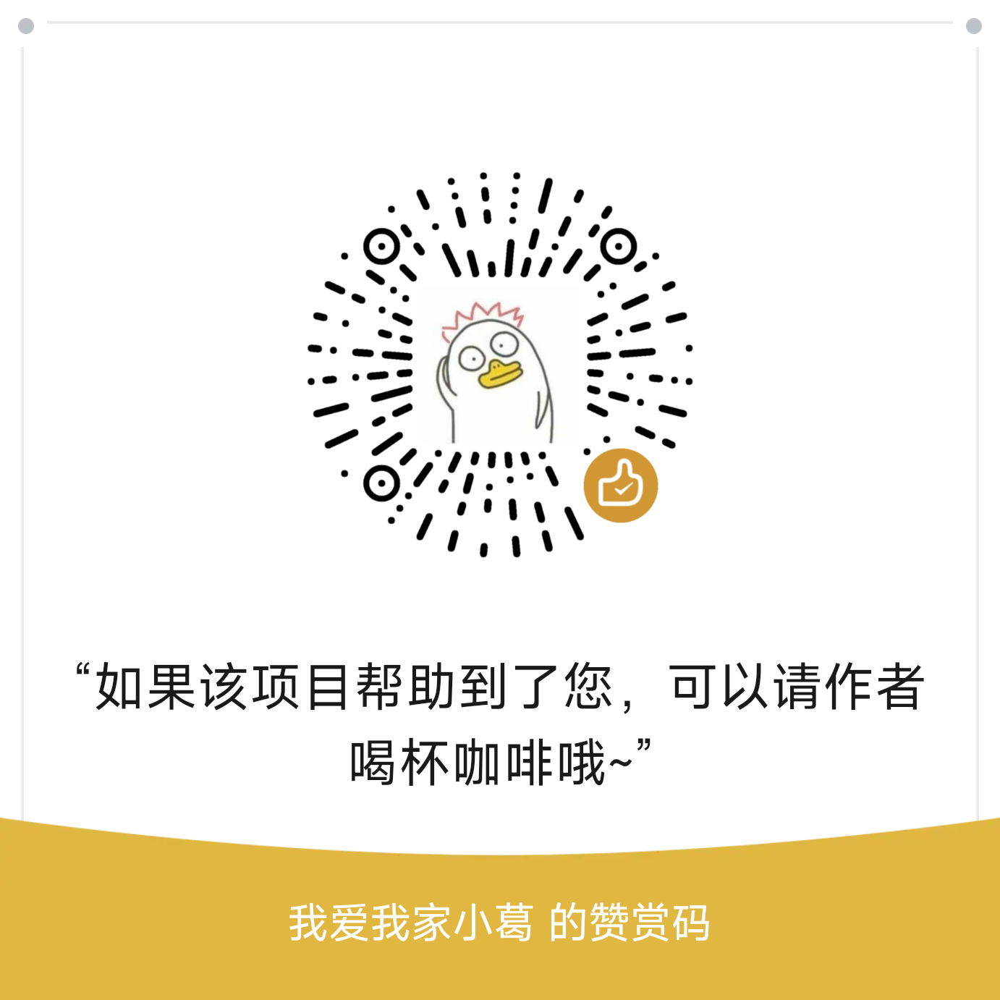
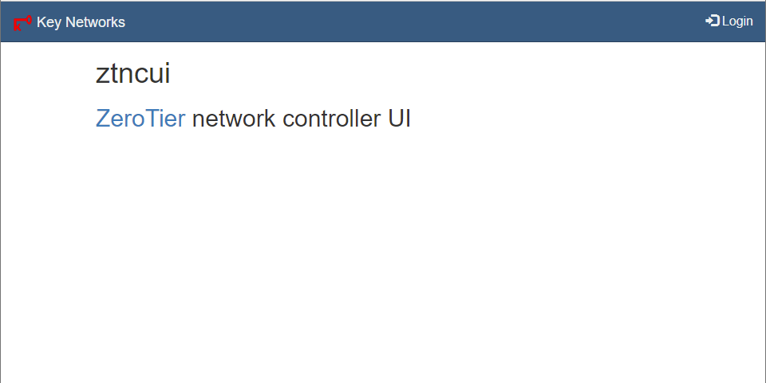
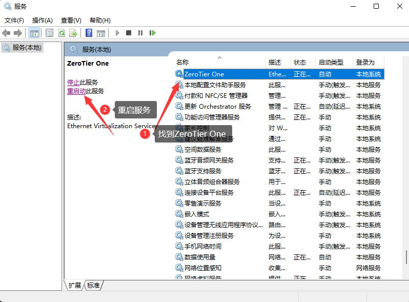

# Docker ZeroTier Planet

[简体中文](README.md) · [English](README.en.md)

Deploy your own ZeroTier Planet on a Linux server with Docker. The deployment also provides a web-based network management interface and a download service for `planet` and `moon` files. It is intended for users who want to manage their own ZeroTier root node and networks.

> **Before you start:** Clients must replace their `planet` file to use the self-hosted Planet. Running your own root node does not guarantee direct connections between devices, nor does it mean all application traffic will—or will not—pass through this server. The management interface uses **HTTP** by default; change the default password promptly after deployment.

<a href="https://edgeone.ai/?from=github">
   CDN acceleration and security protection for this project are sponsored by Tencent EdgeOne
</a>

## Advertisements

- [One-click Rainyun container deployment—buy a server on Rainyun](https://app.rainyun.com/apps/rca/store/6215?ref=220429)
- [MyHeadScale—5 devices free forever, unlimited traffic](https://hs.bj.markxu.vip/?from=github)
- [Bandwagonhost—premium CN2 routes](https://bandwagonhost.com/aff.php?aff=82099)

## Community and Support

- [Telegram group](https://t.me/+JduuWfhSEPdlNDk1)
- QQ groups:
  - 692635772
  - 785620313
  - 316239544
  - 1027678459
  - 651935808

If you find this project helpful, you can support it:



WeChat official account:


## Contents

- [Advertisements](#advertisements)
- [Community and Support](#community-and-support)
- [Quick Start](#quick-start): prepare a server, deploy the container, and create a network
- [Connect Clients](#connect-clients): replace `planet` and join the network on each platform
- [Operations and Security](#operations-and-security): backups, updates, removal, Compose, and HTTPS
- [FAQ](#faq): connectivity, ports, IP changes, and more
- [Project and Community](#project-and-community): roadmap, risk statement, acknowledgments, and references

## Quick Start

### 1. Prepare a Server

Prepare a Linux server with a **public IPv4 address**, and install Docker and Git. The deployment script targets Linux; the image build script targets `linux/amd64` and `linux/arm64`. If you have not installed Docker, consult the [official Docker installation guide](https://docs.docker.com/engine/install/).

Allow the ports you actually use through both the server firewall and your cloud provider's security group. You can change the default ports when the installer prompts you:

| Default port | Protocol | Purpose |
| --- | --- | --- |
| `9994` | TCP, UDP | ZeroTier communication |
| `3443` | TCP | Web management interface; **HTTP** by default, not HTTPS |
| `3000` | TCP | `planet` / `moon` download service; expose it externally only if remote downloads are needed |

> Avoid exposing the management interface or download endpoint to untrusted users. Treat download links and their keys as credentials.

### 2. Run the Deployment Script

```bash
git clone https://github.com/xubiaolin/docker-zerotier-planet.git
cd docker-zerotier-planet
./deploy.sh
```

Select **1. Install** and enter the ZeroTier, management interface, and file download ports. Then choose whether to detect your server's public IP automatically or enter it manually.

The deployment script creates a container with `docker run`; this repository does not include a Compose configuration file.

**Do not choose Install again on an existing deployment without a backup: it deletes `data/zerotier/` under the current project directory. Choose Update for an upgrade.** If the image cannot be pulled, check Docker's access to the image registry before replacing any existing Docker configuration on your server.

Run the script from the project directory: its data paths are based on your current working directory.

After deployment, check the container and its logs:

```bash
docker ps --filter name=myztplanet
docker logs myztplanet
```

### 3. Create a Network and Download Files

1. Open `http://<server-public-IP>:3443` (or the management port you selected) and sign in. **The default username is `admin` and the default password is `password`; change the password immediately after your first login.**
2. On the **Networks** page, click **Add Network**, enter a name, and create the network. Record the generated **Network ID**. To assign virtual IP addresses automatically, configure a range under **Easy Setup** in the network settings.
3. Obtain the `planet` file from the download URL printed by the script or from `./data/zerotier/dist/` on the server. Distribute it to clients that need to connect to this private Planet. The `moon` file is generated in the same directory; this deployment also configures the node itself as a moon, and other nodes may download the file as needed.



> **Back up the entire `data/zerotier/` directory.** In addition to downloadable client files, it contains node identities, signing keys, controller data, and management interface data. Do not commit this directory or download keys to a public repository.

### What's Included

| Component | Purpose |
| --- | --- |
| Planet | ZeroTier root node that helps clients discover the network; clients need the `planet` file generated by this project |
| Moon | This deployment also configures the node as a moon and creates a `.moon` file in `dist` for other nodes to use as needed |
| Controller / web management interface | Create networks, authorize members, and manage address assignments |
| File download service | Provides access to generated files; keep the download key secure |

ZeroTier attempts to connect nodes directly. Whether a direct connection succeeds still depends on both sides' networks, NAT, and firewalls. A self-hosted Planet does not replace end-to-end connectivity troubleshooting.

## Connect Clients

**General process:** Install ZeroTier on the client → back up the existing `planet` file (if any) → put the newly generated file in place → restart the ZeroTier service → join the Network ID you created → authorize the device in the management interface → check its assigned address and connection status.

In the commands below, `0123456789abcdef` is only an **example Network ID**. Replace it with the ID of your own network. Installation paths may vary by distribution and client version; check the actual location on your device.

### Windows

1. Install the [ZeroTier One client](https://www.zerotier.com/download/). Back up any existing file, then put the generated `planet` file at `C:\ProgramData\ZeroTier\One\planet` (`ProgramData` is hidden by default).
2. Restart **ZeroTier One** in Windows Services. In an administrator terminal where `zerotier-cli.bat` is available, join the network:

   ```powershell
   zerotier-cli.bat join 0123456789abcdef
   zerotier-cli.bat peers
   ```

3. Find the device in the management interface, select **Authorized**, and confirm that it receives a virtual IP address. The `peers` output shows the connection status of the Planet and other nodes; **a DIRECT connection to the Planet does not mean every connection between devices is also direct**.



### Linux

Back up any existing `planet` file and copy the new file into the ZeroTier data directory (usually `/var/lib/zerotier-one/planet`). Restart the service and join the network:

```bash
sudo cp planet /var/lib/zerotier-one/planet
sudo systemctl restart zerotier-one
sudo zerotier-cli join 0123456789abcdef
sudo zerotier-cli peers
```

Back up the file at the destination before overwriting it. If your system does not use systemd, use its corresponding service management command. Finally, authorize the device in the management interface.

### macOS

Back up the existing `planet` file and put the new one in `/Library/Application Support/ZeroTier/One/`. Restart ZeroTier One, join the network, and authorize the device in the management interface. The path contains spaces; quote it correctly when working in a terminal. Use the restart method appropriate for your installed client version.

### OpenWrt

First confirm that your ZeroTier plugin supports a custom `planet` file and identify its actual data directory. Some plugins use `/etc/config/zero/planet`. Put the file in the appropriate location, restart ZeroTier in the OpenWrt web interface, join the network, and authorize the device. **Do not create or overwrite system symlinks without verifying the directory layout.**

### Android and iOS

- **Android:** You can refer to the third-party client [ZerotierFix](https://github.com/kaaass/ZerotierFix), which supports custom Planet files. Check its version compatibility and maintenance status before use.
- **iOS:** Replacing `planet` requires support from the client or the operating system. You can look into unofficial solutions such as [ZeroTieriOSFix](https://github.com/lemon4ex/ZeroTieriOSFix); assess their requirements and risks yourself. **WireGuard is a different protocol and cannot join a network created by this project as a ZeroTier client.**

## Operations and Security

### Data Directories and Backups

The deployment script mounts the following host directories into the container. Back up all of `data/zerotier/`, not just the `planet` file:

| Host path | Purpose |
| --- | --- |
| `data/zerotier/dist/` | Exported `planet` / `moon` files |
| `data/zerotier/ztncui/` | Management interface configuration and login data |
| `data/zerotier/one/` | ZeroTier identity and controller data |
| `data/zerotier/config/` | Configuration and keys used to generate the Planet |

**Back up before updating.** Choosing Update in `./deploy.sh` retains mounted data but recreates the container. Watch for the data-deletion warning before choosing Install again; it is not a lossless upgrade. When the data directory is nonempty, the deployment does not automatically regenerate `planet` / `moon`: **changing an IP address or port environment variable alone will not update the generated node information or client files.**

### Protect the Management and Download Endpoints

- Change the default password immediately after the first login. The management interface uses `http://` by default; port `3443` **does not imply TLS**.
- Restrict access to the management port with a firewall. If exposing the interface externally, consider terminating HTTPS with a reverse proxy such as Nginx.
- Do not share download links or keys publicly. The file service reads `SECRET_KEY` for its download key. If it is not fixed, the container generates a new key after a restart and old download links stop working. The image's `FILE_KEY` variable is **not** read by the file service.

The following example assumes Nginx and the container run on the same host, you already have a certificate, and `3443` is the management port you mapped. Also restrict direct public access to `3443` with a firewall:

```nginx
server {
    listen 80;
    server_name planet.example.com;
    return 301 https://$host$request_uri;
}

server {
    listen 443 ssl;
    server_name planet.example.com;

    ssl_certificate /path/to/fullchain.pem;
    ssl_certificate_key /path/to/privkey.pem;
    ssl_protocols TLSv1.2 TLSv1.3;

    location / {
        proxy_pass http://127.0.0.1:3443;
        proxy_set_header Host $host;
        proxy_set_header X-Real-IP $remote_addr;
        proxy_set_header X-Forwarded-For $proxy_add_x_forwarded_for;
        proxy_set_header X-Forwarded-Proto $scheme;
    }
}
```

### Using Docker Compose (Manual Setup)

This repository **does not include** a `compose.yaml`. If you prefer not to use the interactive deployment script, save the following example as `compose.yaml`, replace the public IPv4 address and `SECRET_KEY` with your own values (use a long random key), then run `docker compose up -d` from the directory containing the file:

```yaml
services:
  myztplanet:
    image: xubiaolin/zerotier-planet:latest
    container_name: myztplanet
    restart: unless-stopped
    ports:
      - "9994:9994/tcp"
      - "9994:9994/udp"
      - "3443:3443/tcp"
      - "3000:3000/tcp"
    environment:
      IP_ADDR4: "203.0.113.10" # Replace with your server's public IPv4 address
      IP_ADDR6: "" # If empty, the container still attempts to detect a public IPv6 address
      ZT_PORT: "9994"
      API_PORT: "3443"
      FILE_SERVER_PORT: "3000"
      SECRET_KEY: "replace-with-a-long-random-secret"
    volumes:
      - ./data/zerotier/dist:/app/dist
      - ./data/zerotier/ztncui:/app/ztncui
      - ./data/zerotier/one:/var/lib/zerotier-one
      - ./data/zerotier/config:/app/config
```

> Keep the example's port mappings and container environment variables in sync. If you change a listening port, update its mapping and your firewall rules too. **Do not commit a Compose file containing your real public IP address, download key, or private configuration to a public repository.** Manual Compose deployment does not provide the `deploy.sh` interactive workflow; check `docker logs myztplanet` when troubleshooting.

### Uninstall

Run `./deploy.sh` from the project directory and select Uninstall from the menu. If you manage the container manually, you can run `docker rm -f myztplanet`; **this removes the container, not the host's `data/zerotier/` directory**. Inspect and back up the directory before deleting its contents.

## FAQ

### Why can't I connect to the self-hosted Planet?

First confirm that the client uses the `planet` file generated by the **current deployment** and that ZeroTier has been restarted. Then check the server's public IP address, the container mappings for `9994/tcp` and `9994/udp`, the server firewall, and your cloud provider's security group. Use your actual port numbers if you customized them.

### I joined the network. Why can't I ping another device?

Confirm that both devices joined the **same Network ID**, are authorized in the management interface, and received addresses. Then check whether the destination device's OS firewall permits ICMP and the required application ports. `join OK` alone does not prove the connection works.

### How do I tell whether a connection is direct or relayed?

Run `zerotier-cli peers` on the client and inspect the connection status of the target node. `DIRECT` means that particular connection is direct; `RELAY` means it is relayed. A `DIRECT` connection to the Planet does not guarantee direct connections to other LEAF nodes.

### Why can't I see the official ZeroTier Planet?

After a client replaces its `planet` file with the one generated by this project, its root-node list points to the self-hosted Planet instead of showing the official Planet. Make sure this is the behavior you intend.

### What if the server's public IP or communication port changes?

Back up all of `data/zerotier/`, plan the redeployment, generate a `planet` file matching the new address, and redistribute it to clients. If the existing data directory is nonempty, **restarting the container or changing an environment variable alone will not regenerate the file**. Reinstalling may delete the old data and identity, so back up first.

### What if I forget the management password?

Run `./deploy.sh` from the project directory and select Reset Password from the menu. The script restores the default password, `password`, and restarts the container; change it immediately after signing in. Do not delete `data/zerotier/` to reset a password—it also contains node and network data.

### Are custom domains and ARM servers supported?

You can access the management interface through a domain and reverse proxy. Planet generation uses `IP_ADDR4` / `IP_ADDR6` for node addresses; you cannot simply substitute a domain name for an IP address. The image build script includes `linux/arm64` and `linux/amd64`; confirm that the image you pull includes the architecture you need.

### Why is no virtual network interface created inside a PVE LXC container?

ZeroTier needs access to the TUN device. Check TUN device mapping, permissions, and networking for your Proxmox / LXC version. Changing the container's privilege mode or loosening device permissions affects its security boundary; do not apply old configuration snippets without understanding their effects.

## Project and Community

### Roadmap

- [ ] Support multiple Planets
- [x] Customize the management interface port
- [ ] Deploy Planet and Controller separately

### Risk Statement

This project is for learning and research. Self-hosting requires you to maintain your server, credentials, and client configuration. Evaluate the security and availability risks and comply with applicable laws and service terms. The maintainers are not liable for losses arising from use of this project.

### Acknowledgments

Thanks to the following supporters (in their original order):

随性、我、你好、Calvin、小猪猪的饲养员、情若犹在、天天星期天、啊乐、夏末秋至、\*\*忠、岸芷汀兰、Kimi Chen、匿名、阳光报告旷课、濂溪先生、Water、匿名、匿名、陆、精钢葫芦娃、唯、王小新、匿名、Duck不必。

### Related Projects and References

- [WireGuard One-Click Script](https://github.com/xubiaolin/wireguard-onekey)
- [ZeroTier Virtual LAN Explained](https://www.glimmer.ltd/2021/3299983056/)
- [Build a ZeroTier Planet / Controller in Five Minutes](https://v2ex.com/t/799623)
