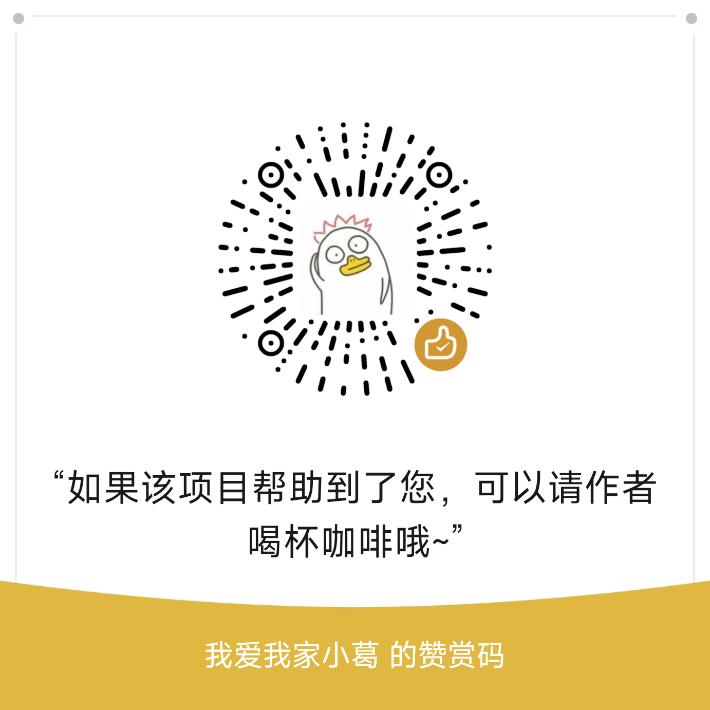
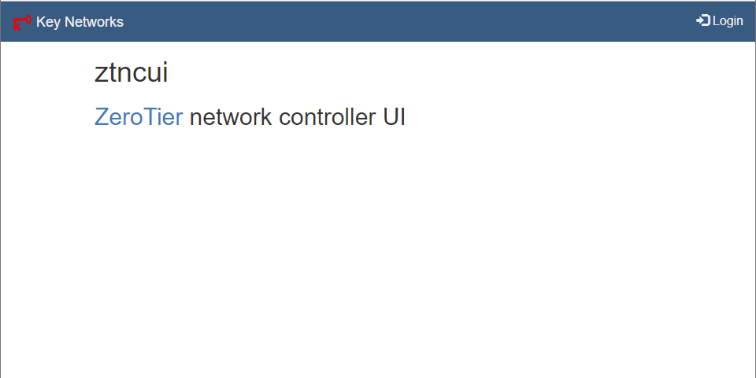
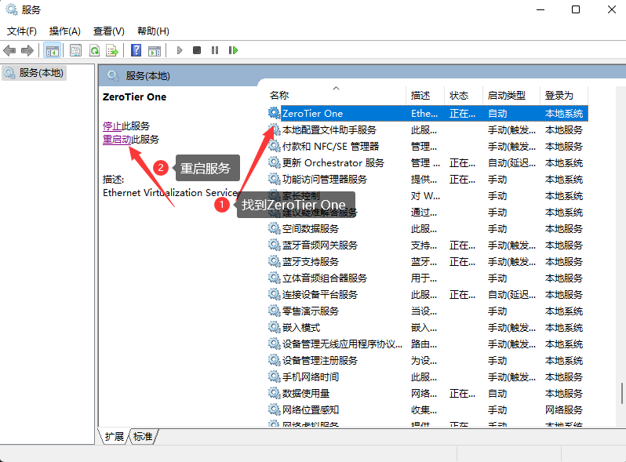

# Docker ZeroTier Planet

[简体中文](README.md) · [English](README.en.md)

使用 Docker 在 Linux 服务器上部署自己的 ZeroTier Planet，同时提供网络管理界面和 `planet` / `moon` 文件下载服务。适合希望自行管理 ZeroTier 根节点与网络的用户。

> **先了解：**客户端需要替换 `planet` 文件才能使用自建 Planet；自建根节点不保证设备间一定直连，也不等于所有业务流量都经过或都不经过这台服务器。新装的管理界面默认只在宿主机本地提供 HTTP 访问。

<a href="https://edgeone.ai/?from=github">
   本项目的 CDN 加速和安全保护由腾讯 EdgeOne 赞助
</a>

## 广告

- [雨云容器服务一键部署-买服务器上雨云](https://app.rainyun.com/apps/rca/store/6215?ref=220429)
- [MyHeadScale-5台设备永久免费-不限流量](https://hs.bj.markxu.vip/?from=github)
- [Bandwagonhost-CN2 优质线路](https://bandwagonhost.com/aff.php?aff=82099)

## 交流与支持

- [Telegram 交流群](https://t.me/+JduuWfhSEPdlNDk1)
- QQ 群：
  - 692635772
  - 785620313
  - 316239544
  - 1027678459
  - 651935808

如果项目对你有帮助，也可以支持该项目



微信公众号：


## 阅读导航

- [广告](#广告)
- [交流与支持](#交流与支持)
- [快速开始](#快速开始)：准备服务器、部署容器、创建网络
- [客户端接入](#客户端接入)：分平台替换 `planet` 并加入网络
- [运维与安全](#运维与安全)：数据备份、更新、卸载、Compose 与 HTTPS
- [常见问题](#常见问题)：连接、端口、IP 变更等
- [项目与社区](#项目与社区)：开发计划、风险声明、致谢与参考资料

## 快速开始

### 1. 准备服务器

准备一台有**公网 IPv4 或 IPv6 地址**的 Linux 服务器，安装 Docker 和 Git，并确保宿主机提供 `flock` 和 `findmnt`（util-linux）。镜像验证流程覆盖 `linux/amd64` 和 `linux/arm64`。尚未安装 Docker 时，可参考 [Docker 官方安装文档](https://docs.docker.com/engine/install/)。

在服务器防火墙和云平台安全组中放行实际使用的端口（安装时可按提示修改默认值）：

| 默认端口 | 协议 | 用途 |
| --- | --- | --- |
| `9994` | TCP、UDP | ZeroTier 通信 |
| `3443` | TCP | Web 管理界面，新装默认只绑定 `127.0.0.1`，无需在公网防火墙放行 |
| `3000` | TCP | `planet` / `moon` 文件下载服务；仅在需要远程下载时对外开放 |

> 不建议将管理界面或文件下载入口直接暴露给不受信任的访问者。下载链接中的密钥也应当按凭据保管。

依赖回环绑定限制管理入口时，请使用 Docker Engine 28.0.0 或更新版本。旧版 Docker 同一二层网络上的主机可能访问该端口，请先用宿主机防火墙限制访问。 [Docker 端口发布说明](https://docs.docker.com/engine/network/port-publishing/)

### 2. 运行部署脚本

```bash
git clone https://github.com/xubiaolin/docker-zerotier-planet.git
cd docker-zerotier-planet
./deploy.sh
```

首次部署选择 **1. 安装或重装（保留已有数据）**，依次填写 ZeroTier、管理界面和文件下载端口，并选择自动获取或手动填写服务器公网 IP。脚本直接调用 Docker，将配置和数据保存在当前目录的 `data/zerotier/`。

**安装中断或需要重装时，回到原项目目录，再选 1。** 脚本沿用已保存的 IP、端口和节点身份。初次启动因端口占用而失败时，重试可修正端口。新版容器停止时会尝试启动它，容器缺失时会从原数据重建。若旧版容器已停止或无法通过健康检查，脚本会使用升级备份流程恢复实例。要主动升级健康实例，请选 **3. 更新**。

默认使用 `xubiaolin/zerotier-planet:latest`。如果选中的默认镜像仍是旧版，菜单会从当前项目源码构建新版。首次构建需要下载依赖并编译 ZeroTier，升级时这些工作在停服前完成。若镜像拉取失败，先检查 Docker 到镜像仓库的连接。

也可以提前构建镜像，把部署主机上的镜像 ID 传给菜单。通过 `DOCKER_IMAGE` 指定的镜像请使用当前源码构建或经当前发布流程验证的版本。新装选 **1**，从已有部署升级选 **3**。如在另一台主机构建，请使用与部署主机一致的架构，并先将镜像导入部署主机。

```bash
docker build -t zerotier-planet:local .
DOCKER_IMAGE=$(docker image inspect --format '{{.Id}}' zerotier-planet:local) ./deploy.sh
```

部署后可检查容器和日志：

```bash
docker ps --filter name=myztplanet
docker logs myztplanet
```

### 3. 创建网络并下载文件

1. 在宿主机领取随机生成的首次密码：

   ```bash
   docker exec myztplanet node /app/admin-password.js initial
   ```

   该命令成功领取后不会再次显示此密码。新装访问 `http://127.0.0.1:3443`，以 `admin` 登录。远程操作可先运行 `ssh -L 3443:127.0.0.1:3443 user@server`，再在本机打开该地址。修改过容器名称或管理端口时，请使用实际值。
2. 在 **Networks** 页面点击 **Add Network**，填写名称并创建网络，记下生成的 **Network ID**。需要自动分配虚拟 IP 时，在网络设置中使用 **Easy Setup** 配置地址段。
3. 从部署完成时脚本给出的下载地址，或从服务器的 `./data/zerotier/dist/` 获取 `planet` 文件，将它分发给需要连接此私有 Planet 的客户端。`moon` 文件同样生成在该目录中，本项目已把节点自身配置为 moon，其他节点按需下载使用。



> **请备份整个 `data/zerotier/` 目录。**其中不仅有供客户端下载的文件，还包含节点身份、签名密钥、控制器和管理界面数据。不要将该目录或下载密钥提交到公开仓库。

### 这套部署包含什么

| 组件 | 作用 |
| --- | --- |
| Planet | ZeroTier 根节点，帮助客户端发现网络；客户端需使用本项目生成的 `planet` 文件 |
| Moon | 部署时会把本节点同时配置为 moon，并在 `dist` 目录生成 `.moon` 文件，供其他节点按需使用 |
| Controller / Web 管理界面 | 创建网络、授权成员并管理地址分配 |
| 文件下载服务 | 提供生成文件的下载入口；下载密钥需要妥善保存 |

ZeroTier 会尝试让节点直接通信；是否能够直连仍取决于双方网络、NAT 和防火墙环境。自建 Planet 不能替代端到端连通性排查。

## 客户端接入

**通用流程：**在客户端安装 ZeroTier → 备份原有 `planet`（如果存在）→ 放入服务器生成的新文件 → 重启 ZeroTier 服务 → 加入创建的 Network ID → 在管理界面授权设备 → 检查分配地址和连接状态。

下面命令中的 `0123456789abcdef` 仅作为 **Network ID 示例**，执行时请替换为自己创建的 ID。不同发行版或客户端版本的安装路径可能不同，请以实际安装位置为准。

### Windows

1. 安装 [ZeroTier One 客户端](https://www.zerotier.com/download/)，将生成的 `planet` 放到 `C:\ProgramData\ZeroTier\One\planet`（`ProgramData` 默认隐藏）；覆盖前备份原文件。
2. 在 Windows“服务”中重启 **ZeroTier One**，再在可调用 `zerotier-cli.bat` 的管理员终端加入网络：

   ```powershell
   zerotier-cli.bat join 0123456789abcdef
   zerotier-cli.bat peers
   ```

3. 在管理界面的成员列表中勾选该设备的 **Authorized**，确认它获得虚拟 IP。`peers` 输出中可查看 Planet 和其他节点的连接状态；**Planet 为 DIRECT 不代表所有设备之间也都直连**。



### Linux

将 `planet` 备份并复制到 ZeroTier 数据目录（通常是 `/var/lib/zerotier-one/planet`），重启服务，然后加入网络：

```bash
sudo cp planet /var/lib/zerotier-one/planet
sudo systemctl restart zerotier-one
sudo zerotier-cli join 0123456789abcdef
sudo zerotier-cli peers
```

覆盖前请先备份目标路径已有的文件；如果系统没有使用 systemd，请使用该系统对应的服务管理命令。最后回到管理界面授权该设备。

### macOS

将 `planet` 备份并放入 `/Library/Application Support/ZeroTier/One/`，重启 ZeroTier One 后加入网络，并在管理界面授权。路径中包含空格；使用终端操作时需要正确引用路径。服务重启方式以当前安装版本为准。

### OpenWrt

先确认所安装的 ZeroTier 插件是否支持自定义 `planet`，以及它实际使用的数据目录。部分插件使用 `/etc/config/zero/planet`；放入文件后在 OpenWrt 管理界面重启 ZeroTier，再加入网络并授权设备。**不要在未核实目录的情况下直接创建或覆盖系统软链接。**

### Android 与 iOS

- **Android：**可参考支持自定义 Planet 的第三方客户端 [ZerotierFix](https://github.com/kaaass/ZerotierFix)，使用前请自行检查其版本兼容性及维护状态。
- **iOS** 的官方 ZeroTier One 在 1.14.2 加入了自定义 Planet。该版本可将 `base64 -w0 ./data/zerotier/dist/planet` 在 Linux 上的输出粘贴到 App 的「设置 → Planet → 编辑」，保存后加入 Network ID，并在管理界面授权。1.16.0 的官方发行说明列出了通过链接或二维码导入 Planet 的功能，也有 iOS 用户报告设置入口消失或扫码后未出现导入提示。服务端升级到 1.16.2 后仍需核对手机上的客户端版本。[App Store 版本记录](https://apps.apple.com/us/app/zerotier-one/id1084101492) · [1.14.2 操作截图](https://github.com/xubiaolin/docker-zerotier-planet/issues/211) · [官方发行说明](https://docs.zerotier.com/changelog/) · [1.16.0 导入反馈](https://github.com/zerotier/ZeroTierOne/issues/2599)

## 运维与安全

### 数据目录与备份

部署脚本将以下宿主机目录挂载进容器；备份时应保留整个 `data/zerotier/`，而不只是 `planet` 文件：

| 宿主机路径 | 用途 |
| --- | --- |
| `data/zerotier/dist/` | 导出的 `planet` / `moon` 文件 |
| `data/zerotier/ztncui/` | 管理界面配置与登录数据 |
| `data/zerotier/one/` | ZeroTier 节点身份、Planet 与 Moon 签名材料、控制器网络和成员数据 |
| `data/zerotier/config/` | 公网 IP、端口与文件下载密钥 |

### 原地升级与故障恢复

支持将 `data/`、`data/zerotier/` 链接到其他磁盘，也支持直接将磁盘挂载在 `data/zerotier/` 或表中的四个持久化目录。升级会在 `data/` 中备份完整数据树。回滚时请保持原来的挂载，脚本会核对磁盘并还原四个目录，然后启动旧容器。若四个目录分别指向外部路径，请在对应目录使用绑定挂载（bind mount）。请将挂载点设在表中目录本身，更深层的挂载会在停服前被检出。

自动升级适用于连接到单个 Docker bridge 网络、且已发布 ZeroTier 的 TCP 和 UDP 端口、管理端口和下载端口的容器。脚本在停服前核对实际挂载和网络配置。已记录的宿主机绑定会随升级和重装保留。若旧容器已丢失且没有绑定记录，重装会先请你确认默认发布方式。

带静态 IP 或自定义网络别名的容器需要手动升级，并在重建时带上这些设置。若旧容器已停止且没有挂载记录，先核实数据盘并启动原容器，再执行自动升级或删除数据。

1. 在原项目目录运行 `./deploy.sh`，选择 **3. 更新**。默认会先拉取镜像，再与当前容器比较镜像 ID。如果有新版本，确认升级后会停止旧容器并备份整个 `data/zerotier/`。升级期间服务会短暂停止，磁盘需能容纳一份完整的数据副本。
2. 脚本会检查 ZeroTier 本地控制接口、管理页面和带密钥的 `planet` 下载。新容器通过检查且实际端口绑定与升级前一致后，脚本删除旧容器，并输出升级前的数据备份路径，默认位于 `data/zerotier.backup.<标识>/data/`。备份中包含私钥。已接入的客户端继续使用原有的 `planet`、Network ID 和授权。
3. 备份失败时，脚本会尝试重新启动旧容器。新容器启动或健康检查失败时，脚本会自动还原升级前的数据与旧容器。若升级进程中断，请在原项目目录重新运行 `./deploy.sh`，选择 **4. 查看信息**。脚本会先处理未完成的升级。回滚完成后，若旧服务仍未就绪，菜单仍可用于后续维修。

安装重试时，若日志提示身份或签名材料缺失或互不匹配，请保留当前目录。若有完整备份，可停止容器，把当前数据目录移到一旁，再把同一次备份的完整目录恢复为 `data/zerotier/`，保留文件属主和权限。使用与备份配套的镜像启动服务。单独的 `dist/planet` 无法还原服务器的私钥、网络或成员授权。

### 保护管理界面和下载入口

- 将首次密码和重置密码保存到密码管理器。新装的公开端口无需包含管理端口。
- 远程管理可使用 SSH 隧道或 HTTPS 反向代理。升级会沿用旧容器的绑定，原先对公网开放的管理端口需要通过防火墙限制访问。
- 升级时会轮换仍使用出厂密码的旧 `admin` 账号。可用首次密码领取命令取回随机密码。已自定义的密码会沿用。
- 下载链接和相关密钥应按凭据保管。新版文件服务复用 `data/zerotier/config/file_server.key`。首次生成时使用 `SECRET_KEY`，未设置则生成随机密钥。回滚到旧版镜像后，若旧链接失效，可在菜单 **4. 查看信息** 获取当前下载地址。

以下示例假设 Nginx 与容器运行在同一台主机，证书已自行准备，且 `3443` 是实际映射的管理端口。下列配置将 HTTPS 请求转发至宿主机回环地址：

```nginx
server {
    listen 80;
    server_name planet.example.com;
    return 301 https://$host$request_uri;
}

server {
    listen 443 ssl;
    server_name planet.example.com;

    ssl_certificate /path/to/fullchain.pem;
    ssl_certificate_key /path/to/privkey.pem;
    ssl_protocols TLSv1.2 TLSv1.3;

    location / {
        proxy_pass http://127.0.0.1:3443;
        proxy_set_header Host $host;
        proxy_set_header X-Real-IP $remote_addr;
        proxy_set_header X-Forwarded-For $proxy_add_x_forwarded_for;
        proxy_set_header X-Forwarded-Proto $scheme;
    }
}
```

### 使用 Docker Compose（手动方式）

仓库**没有附带** `compose.yaml`。如果不使用交互式部署脚本，可将以下示例保存为源码根目录的 `compose.yaml`。填入实际公网地址和足够长的随机 `SECRET_KEY`，再运行 `docker compose up -d --build`：

```yaml
services:
  myztplanet:
    build: .
    image: zerotier-planet:local
    container_name: myztplanet
    restart: unless-stopped
    ports:
      - "9994:9994/tcp"
      - "9994:9994/udp"
      - "127.0.0.1:3443:3443/tcp"
      - "3000:3000/tcp"
    environment:
      IP_ADDR4: "203.0.113.10" # 替换为服务器公网 IPv4
      IP_ADDR6: "" # 双栈部署时填写公网 IPv6
      ZT_PORT: "9994"
      API_PORT: "3443"
      FILE_SERVER_PORT: "3000"
      SECRET_KEY: "replace-with-a-long-random-secret"
    volumes:
      - ./data/zerotier/dist:/app/dist
      - ./data/zerotier/ztncui:/app/ztncui
      - ./data/zerotier/one:/var/lib/zerotier-one
      - ./data/zerotier/config:/app/config
```

> 示例端口与容器环境变量保持一致；如果修改监听端口，请同步修改映射和防火墙规则。**不要把填有真实公网 IP、下载密钥或私密配置的 Compose 文件提交到公开仓库。**手动用 Compose 更新容器时，请自行停服并备份整个数据目录。自动备份和回滚由 `./deploy.sh` 的“更新”菜单执行。

当外部 ZeroTier UDP 端口和容器内的 `ZT_PORT` 不同时，在容器环境中用 `ZT_ADVERTISED_PORT` 指定客户端实际连接的端口。

### 正式镜像发布

`Verify and publish ZeroTier image` 工作流分别在 `amd64` 和 `arm64` 上验证镜像。手动验证会重新加载本次构建的镜像，并用公开的 Alpine 镜像验证跨任务归档传递。维护者可在 `master` 手动运行并勾选 `publish`，将通过验证的镜像发布到 `xubiaolin/zerotier-planet`。发布任务使用 `dockerhub-production` 环境的 Docker Hub 凭据，并在写入正式标签前确认运行对应当前 `master`。镜像的 `/usr/share/doc/zerotier/SOURCE.txt` 记录对应源码和构建资料。镜像包含 ZeroTier 的源代码可见控制器，发布和商业使用须遵守其许可条款。 [控制器许可](https://github.com/zerotier/ZeroTierOne/blob/1.16.2/nonfree/LICENSE.md)

使用已发布镜像时，可以将 Compose 示例改为 `image: xubiaolin/zerotier-planet:<已验证版本>` 并移除 `build`。

### 卸载

在项目目录运行 `./deploy.sh`，根据菜单提示选择“卸载”。确认删除数据后，脚本会清空配置、节点、管理界面和下载数据。独立挂载和历史升级备份会保留。若手动管理容器，可执行 `docker rm -f myztplanet` 来单独删除容器。

## 常见问题

### 为什么无法连接自建 Planet？

先核对客户端是否使用**当前部署生成的** `planet` 并已重启 ZeroTier；再检查服务器公网 IP，以及 `9994/tcp`、`9994/udp` 的容器端口映射、服务器防火墙和云平台安全组。自定义过端口时，以实际配置为准。

### 已加入网络，为什么仍 ping 不通其他设备？

确认两端都已加入**同一个 Network ID**、在管理界面获得授权并分配了地址；随后检查目标设备操作系统防火墙是否允许 ICMP 和所需业务端口。不能仅凭 `join OK` 判断网络已经可用。

### 如何判断直连还是中转？

在客户端运行 `zerotier-cli peers`，查看目标节点对应的连接状态。`DIRECT` 表示该条连接直连，`RELAY` 表示该条连接经中转；连接到 Planet 为 `DIRECT` 并不保证到其他 LEAF 也直连。

### 为什么看不到 ZeroTier 官方 Planet？

客户端替换为本项目生成的 `planet` 后，根节点列表指向自建 Planet，不会同时显示官方 Planet。请确认使用该文件是你的预期操作。

### 服务器公网 IP 或通信端口变了怎么办？

重装和原地升级都会沿用已有节点地址。迁移公网 IP 或 ZeroTier 通信端口前，请先备份整个 `data/zerotier/`。同步更新节点端点配置和签名文件，并将更新后的 `planet` 和 `moon` 分发给客户端。启动时会检查配置与签名文件的端点是否一致。

### 忘记管理密码怎么办？

在项目目录运行 `./deploy.sh`，选择菜单中的“重置密码”。新版镜像会生成并在终端显示新的随机管理员密码，然后重启容器。旧版镜像请先选择“更新”。重置操作会保留其他管理员账号、节点和网络数据。

### 支持域名或 ARM 服务器吗？

管理界面可以通过域名与反向代理访问；Planet 生成逻辑使用 `IP_ADDR4` / `IP_ADDR6` 填写节点地址，不能简单用域名替代 IP。正式发布流程验证 `linux/arm64` 和 `linux/amd64`。使用已有标签前，请确认它包含对应架构。

### PVE LXC 容器内没有创建虚拟网卡怎么办？

ZeroTier 需要访问 TUN 设备。请按当前 Proxmox / LXC 版本核对容器的 TUN 设备映射、权限和网络配置；修改特权模式或放宽设备权限会改变安全边界，不建议在不了解影响时直接套用旧版配置片段。

## 项目与社区

### 开发计划

- [ ] 多 Planet 支持
- [x] 自定义管理界面端口
- [ ] Planet 与 Controller 分离部署

### 风险声明

本项目用于学习和研究。自行部署需要维护服务器、凭据和客户端配置；请评估安全与可用性风险，并遵守适用的法律及服务条款。项目维护者不对使用本项目产生的损失承担责任。

### 致谢

感谢以下支持项目的朋友（按原名单顺序）：

随性、我、你好、Calvin、小猪猪的饲养员、情若犹在、天天星期天、啊乐、夏末秋至、\*\*忠、岸芷汀兰、Kimi Chen、匿名、阳光报告旷课、濂溪先生、Water、匿名、匿名、陆、精钢葫芦娃、唯、王小新、匿名、Duck不必。

### 相关项目与参考资料

- [WireGuard 一键脚本](https://github.com/xubiaolin/wireguard-onekey)
- [ZeroTier 虚拟局域网详解](https://www.glimmer.ltd/2021/3299983056/)
- [五分钟自建 ZeroTier 的 Planet / Controller](https://v2ex.com/t/799623)
